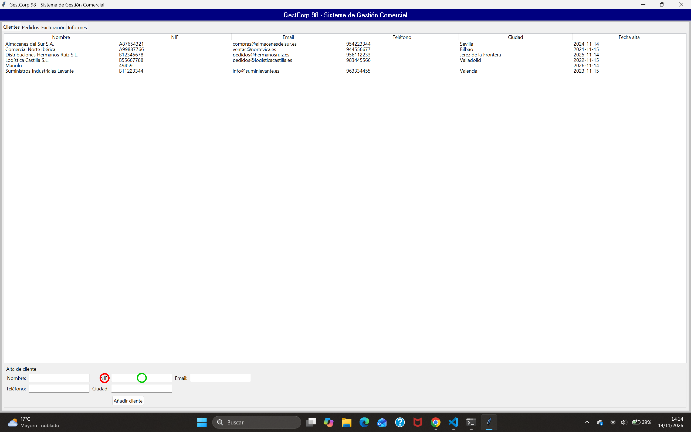
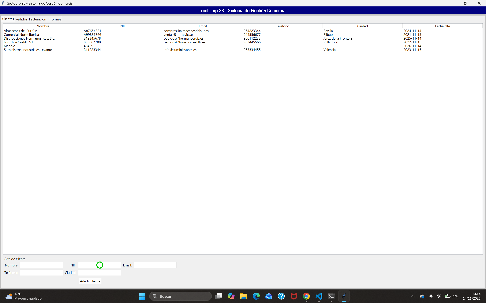
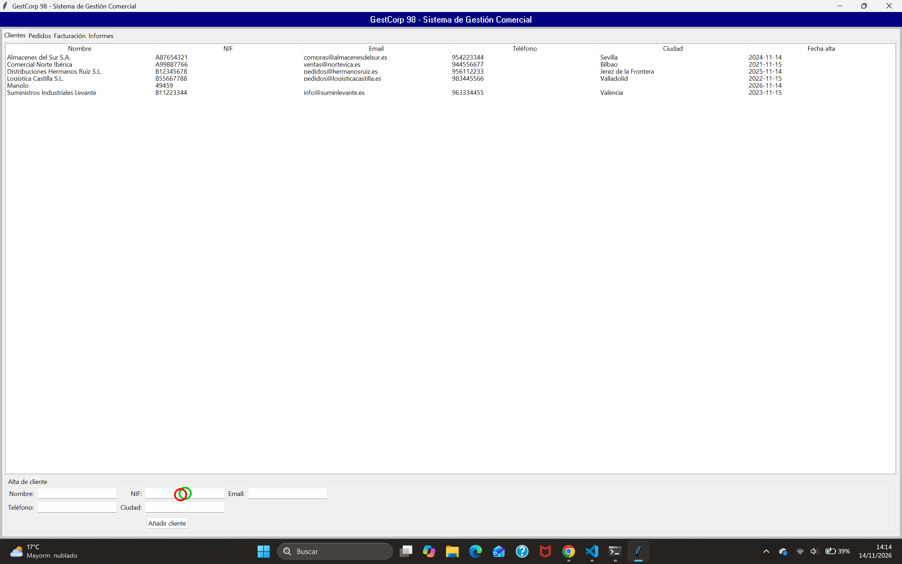
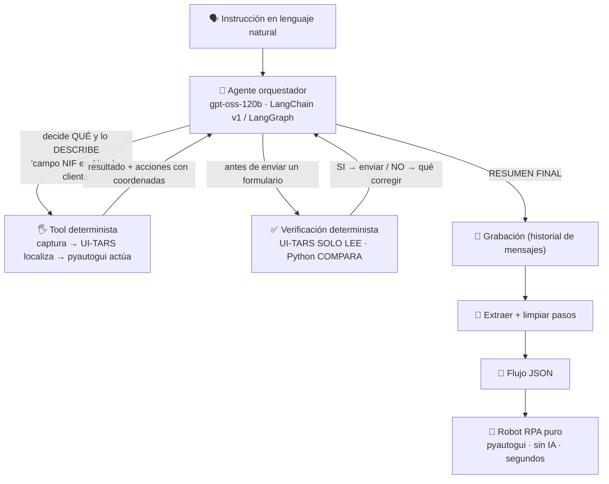

<div align="center">

# 🦥 Automatizando la automatización

### Un agente con **ojos** y **manos** al que explicas la tareas, lo hace y lo convierte en un robot RPA determinista.


**[▶️ Ver la demo completa en vídeo](imagen%20y%20demo/demo.mp4)**: del prompt en lenguaje natural al robot RPA, sin tocar una línea de código.

</div>

---

## 📑 Índice

1. [🎯 Objetivo](#objetivo)
2. [⚙️ Funcionamiento](#funcionamiento)
3. [💡 Contexto (personal)](#contexto)
4. [🛠️ ¿Cómo lo he hecho?](#como-lo-he-hecho)
   1. [🏢 GestCorp 98: el ERP ficticio](#erp)
   2. [🔬 Experimentos: elegir el modelo de visión](#experimentos)
   3. [🧠 El agente: ver → actuar → evaluar → cristalizar](#agente)
      - [👁 Ver](#ver) · [🖐 Actuar](#actuar) · [✅ Evaluar](#evaluar) · [💎 Cristalizar](#cristalizar) · [🔁 El bucle](#bucle)
   4. [🖥️ La plataforma](#plataforma)
   5. [🗂️ Estructura del repositorio](#estructura)
   6. [🚀 Puesta en marcha](#puesta-en-marcha)
   7. [🧭 Límites y hoja de ruta](#limites)

---

<a id="objetivo"></a>
## 1. 🎯 Objetivo

> **Democratizar la automatización segura, determinista y gobernable.**

Un agente que tiene **ojos** (un modelo de visión que entiende interfaces) y **manos** (herramientas
que hacen clic, escriben y eligen en desplegables) recibe en lenguaje natural *qué* quieres
automatizar. Él mira la pantalla, decide **dónde hacer clic** para cumplir el objetivo, **ejecuta**,
**comprueba** lo que ha hecho y **se corrige** si algo sale mal.

Y lo más importante: **la IA solo hace falta una vez.** Cuando el agente termina con éxito, su
ejecución se convierte en un **flujo RPA determinista** (un JSON con cada clic y cada texto) que se
repite en segundos, **sin IA**, siempre igual, y que una persona puede leer, auditar y aprobar.

| | RPA clásico | Agente de IA "a pelo" | **Este proyecto** |
|---|---|---|---|
| ¿Quién lo construye? | Un desarrollador, a mano | Nadie: improvisa cada vez | **El agente, a partir de una explicación** |
| ¿Es determinista? | ✅ | ❌ | ✅ **El robot final no usa IA** |
| ¿Es auditable? | ✅ | ❌ Caja negra | ✅ **Cada paso queda en JSON** |
| Coste por ejecución | Bajo | Alto (tokens + GPU) | **Bajo: la IA solo en la grabación** |
| Tiempo de desarrollo | Días / semanas | — | **Minutos** |

---

<a id="funcionamiento"></a>
## 2. ⚙️ Funcionamiento

En el **Estudio** describes en **lenguaje natural** la tarea que quieres automatizar. A partir de ahí,
el agente **abre tu ERP** y ejecuta lo que le has pedido: **rellena campos**, **hace clics**, **elige
opciones en los desplegables** y **verifica visualmente su propio trabajo**, corrigiendo sus errores
antes de enviar cada formulario.

Después, el flujo que ha seguido el agente se convierte en un **flujo determinista, fijo y
auditable**: un robot que **puedes ejecutar cuando quieras**, en segundos y **sin IA**.

```
  01 · DESCRÍBELO                 02 · EL AGENTE LO HACE                    03 · TU ROBOT, LISTO
 ┌────────────────────┐        ┌──────────────────────────────┐        ┌──────────────────────────┐
 │ "Inicia sesión,    │        │ 👁  mira la pantalla (UI-TARS) │        │ flujo_20261122_192758.json│
 │  da de alta a      │  ───▶  │ 🖐  hace clic / escribe        │  ───▶  │ 12 pasos · coordenadas    │
 │  David y créale    │        │ ✅ verifica cada formulario   │        │ se repite en segundos,    │
 │  un pedido de 3    │        │ 🔁 se corrige si algo está mal │        │ SIN IA                    │
 │  palets…"          │        └──────────────────────────────┘        └──────────────────────────┘
 └────────────────────┘
```

**[▶️ Míralo en acción en la demo](imagen%20y%20demo/demo.mp4)**

---

<a id="contexto"></a>
## 3. 💡 Contexto (personal)

Siempre me he dedicado a **mejorar y automatizar procesos**. A medida que la IA ha ido avanzando,
he ido metiéndola en ese trabajo, pero me chocaba siempre con lo mismo: **muchos procesos requieren
un montón de tiempo de desarrollo técnico**. Localizar cada botón, mapear cada campo, montar el
robot, probarlo, arreglarlo cuando algo cambia… Es trabajo de alguien técnico, que no escala, y en
el que el cuello de botella **soy yo**.

De ahí salió la idea: **una plataforma agéntica en la que cualquiera explique qué clics y qué proceso
quiere automatizar**, como se lo contaría a un compañero, y en la que **un agente con ojos y manos me
sustituya a mí como automatizador**. Que la persona que conoce el proceso no tenga que esperar a
que un técnico se lo programe: lo describe, el agente lo hace delante de ella, lo verifica, y le
entrega un robot listo para repetir.

**Automatizar la propia tarea de automatizar.**

---

<a id="como-lo-he-hecho"></a>
## 4. 🛠️ ¿Cómo lo he hecho?

La parte técnica, en el orden en que la fui construyendo: primero un **ERP ficticio** sobre el que
probar, luego **elegir los ojos** del agente, después **el agente** en sí y, por último, la
**plataforma** para usarlo.

<a id="erp"></a>
### 4.1 🏢 GestCorp 98: el ERP ficticio (banco de pruebas)

Para probar todo esto hacía falta una víctima realista: **una app de escritorio legacy, sin API y
con aspecto de los 90**, como las que siguen manejando muchas empresas. Así nació **GestCorp 98**,
hecha en **Tkinter + SQLite**:

- 🔐 **Login** (usuario / contraseña)
- 👥 **Clientes:** listado, alta con formulario y borrado con clic derecho
- 📦 **Pedidos:** listado y creación con **desplegables** de cliente y producto
- 🧾 **Facturación:** listado de solo lectura
- 📊 **Informes:** datos calculados (p. ej. total de ventas)

La base de datos se crea y se rellena con datos de prueba sola, la primera vez que se abre la app
(`gestcorp98/seed_data.py`). **No es el objetivo final, es el conejillo de indias:** el agente no sabe
nada de su código. Solo ve píxeles, igual que vería SAP, un CRM antiguo o cualquier otra app.

<a id="experimentos"></a>
### 4.2 🔬 Experimentos: cómo se eligió el modelo de visión

Antes de construir el agente había que responder a una pregunta: **¿qué modelo localiza mejor un
elemento de UI a partir de su descripción, incluidos los campos vacíos?** Se montó un **ground
truth** real (`experiments/ground_truth/`: 3 capturas de GestCorp y las coordenadas reales de 7
elementos) y se compararon los candidatos en `experiments/vision_evaluation.ipynb`. En cada imagen,
🟢 es la posición real y 🔴 la predicción.

| Enfoque | Resultado | Veredicto |
|---|---|---|
| **qwen2.5vl:7b** (Ollama) | Usa su propio formato de coordenadas y no se sabe a qué resolución redimensionó la imagen | ❌ Descartado |
| **RapidOCR** | Muy bueno con botones con texto; inútil para campos vacíos. Para *leer* campos, falla (`"seon]"` donde ponía `"Lucas"`) | ⚠️ Baseline |
| **OmniParser v2** (YOLOv8 + Florence-2) | El detector saca cajas precisísimas, incluso en campos vacíos, pero el captioner no sabe **qué caja es cuál** | ⚠️ Detector top, identificación floja |
| **UI-TARS-7B-DPO** | Localiza muy bien **y además responde preguntas sobre la pantalla**, así que sirve también para **verificar** | 🏆 **Elegido** |

<div align="center">

| RapidOCR | OmniParser | UI-TARS |
|:---:|:---:|:---:|
|  |  |  |

*Localizar el campo **vacío** "NIF" del formulario de alta.*

</div>

Todo lo aprendido por el camino (prompts, trucos de Windows y errores) está documentado en
[`docs/aprendizajes-agente-rpa.md`](docs/aprendizajes-agente-rpa.md).

<a id="agente"></a>
### 4.3 🧠 El agente: ver → actuar → evaluar → cristalizar

El corazón del proyecto es un **reparto de papeles muy estricto** entre la IA y el código. Cada pieza
hace solo lo que mejor sabe hacer:

| Quién | Qué hace | Qué **NO** hace |
|---|---|---|
| 🧠 **LLM orquestador** (gpt-oss-120b) | Lee la instrucción, decide el siguiente paso y **describe** el elemento | No calcula coordenadas ni "imagina" resultados |
| 👁 **UI-TARS-7B** (visión) | **Localiza** el elemento descrito / **lee** lo que hay escrito en un campo | No conoce la app ni el objetivo; no compara |
| 🖐 **Tools en Python** | Clic, escribir, borrar, abrir desplegables, **comparar valores** | No deciden nada |
| 🤖 **Robot RPA final** | Repite las acciones grabadas | **No usa IA** |



<a id="ver"></a>
#### 4.3.1 👁 Ver: grounding visual con UI-TARS

El agente no lee el código de la app ni su árbol de accesibilidad: **ve la pantalla como un humano**.
Cada tool hace una captura (con `mss`) **solo de la ventana de la app** y le pide a
[UI-TARS-7B-DPO](https://huggingface.co/ByteDance-Seed/UI-TARS-7B-DPO) que localice el elemento.
UI-TARS responde `click(start_box='(x,y)')` en una escala relativa **0-1000 sobre la imagen original**,
que se pasa a píxeles reales de pantalla.

Detalles que marcan la diferencia (aprendidos a base de fallos):

- **DPI awareness en Windows** antes de tocar `mss`/`pyautogui`. Sin esto, los píxeles de la
  captura y los del ratón no coinciden 1:1.
- **Capturar solo la ventana de la app.** Si el modelo ve también la web de al lado, puede leer o
  localizar texto de ahí.
- **Siempre entero en la GPU** (`device_map="cuda:0"`, no `"auto"`). Con `"auto"`, si falta VRAM,
  manda capas a la CPU sin avisar y cada inferencia se vuelve lentísima.
- **Precarga** del modelo antes de abrir la app, para no esperar en mitad del flujo.

<a id="actuar"></a>
#### 4.3.2 🖐 Actuar: tools "empaquetadas" y deterministas

La primera versión encadenaba pasos sueltos (localizar → clic → escribir → comprobar), y cada uno
era una llamada al LLM: muchos tokens y muchas ocasiones de equivocarse. La versión actual mete
**toda la secuencia física dentro de cada tool**: el LLM solo dice **qué** y **dónde**; el **cómo**
es código.

| Tool | Qué hace por dentro |
|---|---|
| `pulsar(descripcion)` | localizar → clic |
| `rellenar_campo(descripcion, texto)` | localizar → clic → `End` → **pegar** el texto |
| `borrar_campo(descripcion)` | localizar → clic → `End` → 50 × `Backspace` |
| `seleccionar_en_desplegable(desplegable, opcion)` | localizar → abrir → **nueva captura** → localizar la opción "en la lista abierta" → clic |

Cada tool devuelve `resultado` (texto para el LLM) y `acciones` (lo que hizo físicamente, **con
coordenadas**). **De ahí sale después el robot.**

Algunos trucos que no están en ningún tutorial:

- **Pegar en vez de teclear:** `pyautogui.typewrite` se salta en silencio las tildes y la ñ.
- **Borrar con `End` + `Backspace`, no con `Shift+Home`:** con Bloq Num activado, Windows suelta el
  `Shift` y no selecciona nada.
- **El desplegable es una sola tool:** solo ella sabe que la lista acaba de abrirse.
- **Sin umbrales "a ojo":** un número de píxeles elegido a dedo funciona en una pantalla y falla en otra.

<a id="evaluar"></a>
#### 4.3.3 ✅ Evaluar: verificación determinista, **la IA lee y el código decide**

Antes de pulsar "Añadir cliente" o "Crear pedido", el agente **está obligado** a verificar:

1. UI-TARS **solo lee** cada campo, completando una frase corta:
   `En la parte de abajo, en "Alta de cliente", el campo "NIF" es:`
2. **Python** normaliza la respuesta y la **compara** con lo que pidió el usuario.
3. La tool devuelve `SI` / `NO` y, por campo, `BIEN` o `MAL` **con la instrucción exacta para
   corregirlo** (`borrar_campo` + `rellenar_campo`, o volver a elegir en el desplegable).
4. Regla del system prompt: **nunca se envía un formulario sin un `SI` justo antes.**

> 🔑 **A UI-TARS nunca se le da el valor esperado.** Si le preguntas "¿pone 12345?", tiende a darte la
> razón. Solo lee; la comparación la hace el código, y **el código no se deja convencer**.

**La lección de prompting más importante del proyecto:** la primera versión de la pregunta hablaba
del *"hueco blanco justo a la derecha de la etiqueta NIF (no la tabla de arriba)"*. Con ella, UI-TARS
leía el NIF **vacío** aunque estuviera bien escrito: buscaba un *hueco blanco* de verdad (y lo
encontraba en la tabla) y el agente entraba en un bucle de borrar y reescribir sin salida. La
solución fue **acortar**: zona + nombre del campo, una frase para completar, sin suponer el estado,
sin posiciones y sin negaciones.

<a id="cristalizar"></a>
#### 4.3.4 💎 Cristalizar: de la grabación del agente a un RPA determinista

El historial de mensajes del agente es una **grabación** de toda la ejecución. `agente/grabacion.py`
la convierte en un flujo fijo:

1. Recorre las tools de acción y toma sus `acciones` con coordenadas. **Las verificaciones no pasan
   al robot** (el robot no tiene visión).
2. Guarda las coordenadas **relativas a la ventana**, junto con su tamaño.
3. **Limpia** lo que sobra: los `borrar` (cada escritura se reproduce como borrar + escribir), las
   escrituras repetidas en un mismo campo (**solo vale la última**, es decir, la corrección) y los
   clics duplicados.
4. Lo guarda en `experiments/flujos/flujo_AAAAMMDD_HHMMSS.json`, junto con la instrucción original.

```json
{ "accion": "escribir", "elemento": "campo NIF en el formulario Alta de cliente",
  "x": 536, "y": 1358, "texto": "12345" }
```

El resultado: **la IA trabaja una vez; el robot trabaja para siempre.** Rápido, barato, repetible y
legible por una persona.

<a id="bucle"></a>
#### 4.3.5 🔁 El bucle del agente

- **LangChain v1 `create_agent`** (LangGraph por debajo) + `ChatGroq` con `openai/gpt-oss-120b`,
  `temperature=0` y `reasoning_effort="low"` (menos tokens de razonamiento por paso).
- **`agent.stream`** en vez de `invoke`: cada tool y su resultado se emiten **en directo** a la web.
- **Autorreanudación:** si el agente para sin escribir su `RESUMEN FINAL`, o Groq rechaza una
  respuesta mal formada, se le pide que continúe con todo el historial (hasta 5 veces).
- **"Actúa solo con tools":** el system prompt prohíbe describir una acción en texto o inventarse su
  resultado. *Si no has llamado a la tool, no ha pasado.*
- **System prompt genérico y corto:** explica el **método**, no los pasos de una app concreta, porque
  se reenvía en cada paso y cada token cuenta.

<a id="plataforma"></a>
### 4.4 🖥️ La plataforma: Next.js + FastAPI + WebSocket

Una web para **lanzar el agente, ver en directo lo que piensa y hace, y gestionar los robots** que
genera.

- **🏠 Landing:** con un perezoso 3D (Three.js / React Three Fiber) que teclea en su portátil. Porque
  automatizar es, en el fondo, el arte de la pereza bien entendida. 🦥
- **✨ Estudio:** pegas el prompt, pulsas **«Lanzar agente»** y ves la **mente del agente** en una
  línea de tiempo en directo: qué razona, qué herramienta usa, con qué argumentos, qué le devuelve y
  **qué ha leído UI-TARS** en cada verificación. Al terminar, el robot queda guardado.
- **🤖 Robots:** listado de los flujos grabados, el detalle paso a paso de cada uno y un botón para
  **ejecutarlo en directo** con RPA puro, sin IA.

**Arquitectura:**

```
 Navegador (Next.js · :3000)  ◀── WebSocket: eventos en directo ──  FastAPI (:8000)
          │                                                            │
          └──────────── REST: lanzar / detener / listar ──────────────▶│
                                                                       │ hilo aparte
                                                                       ▼
                                                    paquete `agente/` (orquestador, visión, tools)
                                                                       │ pyautogui + mss
                                                                       ▼
                                                              GestCorp 98 (Tkinter)
```

- El backend **no tiene lógica de automatización propia**: lanza el paquete `agente/` en un hilo y
  reenvía sus eventos por WebSocket.
- `agente/eventos.py` **desacopla** el agente de quien lo mira: el agente llama a `emitir(tipo, ...)`,
  y ese evento se imprime en la terminal o viaja por WebSocket a la web, según quién lo esté usando.
- **Solo hay un ratón:** si ya hay una ejecución en marcha, la API responde `409`. Las ejecuciones se
  pueden **detener** entre un paso y el siguiente.

| Método | Ruta | Qué hace |
|---|---|---|
| `GET` | `/estado` | backend vivo y ejecución activa |
| `GET` | `/prompt-ejemplo` | prompt que se precarga en el Estudio |
| `GET` / `DELETE` | `/flujos`, `/flujos/{id}` | robots guardados |
| `POST` | `/ejecuciones/agente` | lanza el agente con un prompt |
| `POST` | `/ejecuciones/robot` | ejecuta un robot grabado |
| `POST` | `/ejecuciones/{id}/detener` | para la ejecución en el siguiente paso |
| `WS` | `/ws/ejecuciones/{id}` | eventos en directo: `tool`, `tool_resultado`, `lectura`, `texto_agente`, `paso`, `robot_guardado`… |

<a id="estructura"></a>
### 4.5 🗂️ Estructura del repositorio

```
.
├── agente/                    🧠 El agente, como paquete de Python
│   ├── orquestador.py         ·  LangChain create_agent + Groq, stream y autorreanudación
│   ├── vision.py              ·  👁 UI-TARS: localizar elementos y leer la pantalla
│   ├── tools_accion.py        ·  🖐 pulsar, rellenar_campo, borrar_campo, seleccionar_en_desplegable
│   ├── verificacion.py        ·  ✅ UI-TARS lee, Python compara → SI / NO
│   ├── grabacion.py           ·  📼 historial del agente → flujo RPA limpio
│   ├── reproductor.py         ·  🤖 ejecuta un flujo con pyautogui, sin IA
│   ├── sesion.py              ·  una ejecución de principio a fin
│   ├── ventana.py             ·  abre/coloca/cierra GestCorp en media pantalla
│   ├── eventos.py             ·  emitir(): terminal o WebSocket
│   ├── prompts.py             ·  system prompt del orquestador
│   └── config.py              ·  modelos, pausas, rutas
│
├── gestcorp98/                🏢 ERP ficticio (Tkinter + SQLite): banco de pruebas
│   ├── main.py
│   ├── database.py · seed_data.py
│   └── ui/                    ·  login, ventana principal y pestañas
│
├── plataforma/                🖥️ Web de gestión
│   ├── backend/               ·  FastAPI + WebSocket
│   └── frontend/              ·  Next.js + TypeScript + Tailwind + React Three Fiber
│
├── experiments/               🔬 Investigación
│   ├── vision_evaluation.ipynb ·  comparativa RapidOCR / OmniParser / UI-TARS
│   ├── vision_evaluation/     ·  imágenes de cada predicción frente al ground truth
│   ├── ground_truth/          ·  capturas + coordenadas reales
│   ├── agentic_pipeline.ipynb ·  el prototipo del agente (de aquí salió `agente/`)
│   ├── vision_tools.py
│   ├── prompts/               ·  user prompts de ejemplo
│   └── flujos/                ·  🤖 robots generados (JSON)
│
├── docs/aprendizajes-agente-rpa.md   📚 Todo lo aprendido, con sus porqués
├── PROJECT.md                 🗺️ Visión y hoja de ruta
└── imagen y demo/             🎬 Captura y vídeo de la demo
```

<a id="puesta-en-marcha"></a>
### 4.6 🚀 Puesta en marcha

#### Requisitos

- **Windows** (el agente mueve el ratón y el teclado de verdad)
- **Python 3.12** con [`uv`](https://docs.astral.sh/uv/)
- **Node.js** (para el frontend)
- **GPU NVIDIA con ~16 GB de VRAM** para UI-TARS-7B en bf16
- Una **API key de [Groq](https://console.groq.com/)** (gratis)

#### Instalación

```powershell
uv sync                                   # dependencias de Python (torch con CUDA incluido)
echo GROQ_API_KEY=tu_clave > .env         # clave de Groq en la raíz del repo
cd plataforma/frontend; npm install       # dependencias del frontend
```

#### Arrancar la plataforma (dos terminales)

```powershell
# Terminal 1: backend (desde la raíz del repo)
uv run uvicorn plataforma.backend.main:app --port 8000

# Terminal 2: frontend
cd plataforma/frontend
npm run dev
```

Abre **http://localhost:3000** y **coloca el navegador en la mitad izquierda de la pantalla**:
GestCorp 98 se abre sola en la derecha. Mientras trabaja el agente o un robot, **el ratón es suyo**. 🙌

#### Otras formas de usarlo

```powershell
uv run python -m gestcorp98.main                                       # abrir GestCorp 98 a mano
uv run python -m agente experiments/prompts/login_alta_cliente.txt     # agente desde la terminal
uv run python -m agente --robot experiments/flujos/<flujo>.json        # ejecutar un robot
```

<a id="limites"></a>
### 4.7 🧭 Límites conocidos y hoja de ruta

Ser honesto con los límites también es parte de construir algo **gobernable**:

- **El robot depende del tamaño y la posición de la ventana.** Si la app cambia de diseño, hay que
  volver a grabar. → *Siguiente paso:* que el robot **pida ayuda a la visión** solo cuando un paso falle.
- **Las tools de verificación son específicas de GestCorp.** → Una verificación **genérica** a la que el
  agente le pase formulario, campo y valor.
- **El agente no "ve" entre acciones.** → Comparar la captura de antes y la de después de cada clic.
- **Próximas piezas** (ver [`PROJECT.md`](PROJECT.md)):
  - 🎙️ explicar el proceso **por voz**;
  - 📝 convertir la explicación en una **lista de pasos editable**, para que el usuario la apruebe antes de ejecutar;
  - 🧩 **skills** reutilizables;
  - 📑 **informes** por ejecución;
  - 🌪️ un **modo caos** en GestCorp para poner a prueba la robustez del pipeline.

---

<div align="center">

**Ver · Actuar · Evaluar · Cristalizar**

*La IA solo trabaja una vez. El robot, para siempre.* 🦥

</div>
